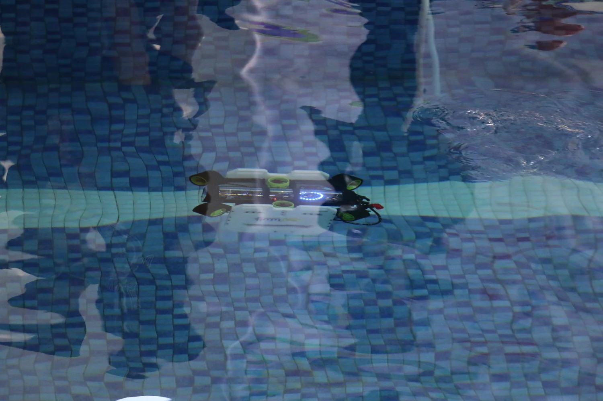

# Ghalih's Engineering Portfolio — Build & Customize Tutorial

Welcome! This is the **editable v2 starter site**, deliberately designed to resemble your PDF engineering portfolio rather than a generic SaaS/tech template.

Your original PDF's visual language is the reference: deep blue panels, pale lavender surrounding pages, oversized condensed type, small blue/blue/gold bars, technical drawings, your cutout portrait, and the "Let's Craft The Future Together" closing page.

**This is a real static website**, not a mockup. You can edit it in VS Code, test it locally, and deploy it without paying for hosting or installing a JavaScript framework.

---

## Chapter 1 — What you need

- A computer with a browser (Chrome, Edge, or Firefox).
- [Visual Studio Code](https://code.visualstudio.com/) to edit the files.
- Optional but recommended: VS Code extension **Live Server** (by Ritwick Dey), which adds "Go Live" to the bottom toolbar.
- Optional for publishing: a free [GitHub](https://github.com/) account and [Git](https://git-scm.com/) installed, **or** a free [Netlify](https://www.netlify.com/) account.

**You do not need** React, Node.js, npm, a database, or a backend to run this site.

## Chapter 2 — Open the project

1. Download the ZIP and extract it somewhere you can easily find it, such as `Documents/ghalih-portfolio/`.
2. In VS Code: **File → Open Folder...** and select the extracted `ghalih-portfolio-v2` folder (the one containing `index.html`).
3. Open `index.html` so you can see how the content is divided into sections.

File structure:

```text
ghalih-portfolio-v2/
│
├── index.html                  ← page structure: hero/about/experience/awards/contact
├── styles.css                  ← colors, typography, layout, responsive design
├── projects.js                 ← ALL project descriptions, pictures, and metrics
├── script.js                   ← filters, mobile menu, pop-up interactions
├── engineering-portfolio.pdf   ← your original PDF (download link on website)
├── favicon.svg                 ← tiny G/S tab icon
├── README.md                   ← this tutorial
└── assets/
    ├── portrait.webp
    ├── auv-pool.webp
    ├── robot-lab.webp
    ├── effector-cad.webp
    └── ...more images extracted from your PDF
```

### What are HTML, CSS and JS?

- **HTML**: what is on the page, and in what order.
- **CSS**: what everything looks like (the blue panels, font sizes, spacing, responsive rules).
- **JavaScript**: what happens when somebody interacts (clicks a project, changes a filter, opens the menu).

Your most common editing destinations will be `index.html`, `styles.css`, and `projects.js`. You usually **do not need to touch `script.js`**.

## Chapter 3 — Run it locally

### Method A: VS Code Live Server (easiest)

1. In VS Code, open **Extensions** with `Ctrl+Shift+X`.
2. Search for `Live Server` and install the extension by Ritwick Dey.
3. Open `index.html`, right-click in the editor, and choose **Open with Live Server**, or click **Go Live**.
4. Your browser should open a local address such as `http://127.0.0.1:5500/index.html`.
5. Edit a file and press `Ctrl+S` — the browser refreshes automatically.

### Method B: use Python (no editor extension)

In a terminal, first change into the website folder:

```bash
cd path/to/ghalih-portfolio-v2
python -m http.server 5500
```

For Windows, if `python` is not recognized, try `py -m http.server 5500`.

Then visit **http://localhost:5500** in the browser. Press `Ctrl+C` in the terminal to stop the server.

**Troubleshooting:** If you open the HTML by double-clicking and an interaction behaves strangely, launch it with Live Server instead. Also verify that `projects.js` is next to `index.html` and the image paths still start with `assets/`.

## Chapter 4 — Customize the visual theme FIRST

Open `styles.css`. At the very beginning, you'll see:

```css
:root {
  --blue: #2a5689;
  --blue-deep: #173f66;
  --blue-darkest: #112f4b;
  --lavender: #e1e6fa;
  --gold: #e8b45d;
  --ink: #19364d;
  --white: #fffdf9;
}
```

These are CSS *variables*. The same colors are reused all over the website, so one change affects multiple sections.

Try changing `--gold` to `#ffc247`, save, and refresh. See how the highlights change on the cover, headings and buttons. Undo with `Ctrl+Z` if you prefer the original.

The display typeface is **Barlow Condensed**, to match the strong narrow typography from the PDF. It's requested through Google Fonts in `index.html`, with local fallback fonts if you're offline. The smaller descriptive text uses DM Sans.

### Want less whitespace or tighter panels?

Search the CSS for `--page-gap`, `.hero`, `.section`, `.about-board`, and `.project-card`. These are the main layout controls.

## Chapter 5 — Change the opening cover

Open `index.html`, then find this line:

```html
<p class="cover-pretitle">ENGINEERING</p>
<h1>PORTFOLIO<span class="heading-dot">.</span></h1>
```

Change the text inside the tags to change the huge heading. For example:

```html
<p class="cover-pretitle">UNDERWATER ROBOTICS</p>
<h1>PORTFOLIO<span class="heading-dot">.</span></h1>
```

You can also replace the intro sentence under `01 / INTRODUCTION`:

```html
<p>I design, build and test <em>machines that move with purpose.</em></p>
```

The `<em>` part is gold. Everything outside it is white.

### Replace a cover image

Put the new image in `assets/`, for example `my-auv.webp`. Then look for:

```html

```

and replace `auv-pool.webp` with `my-auv.webp`. You should also update the `alt` text to explain the new image. The right side of the cover also contains `assets/robot-cad.webp`, which you can replace the same way.

**Recommended images:** use actual photographs of your vehicle, robot, mechanism, or experiments. WebP or JPG is great. For hero photos, 1400–2000 pixels wide is usually enough; avoid uploading 20 MB camera originals directly.

## Chapter 6 — Customize your About Me section

Still in `index.html`, search for:

```html
<section class="section about-section" id="about">
```

This is the section inspired by **page 2** of your PDF. You can change:

- The large background word `GHALIH.` (inside `<div class="about-word">`).
- The headline in `<h3>`, where `<span>` marks gold text.
- Your bio in `<p>`.
- The portrait at `assets/portrait.webp`.

Keep the picture's transparent background if you want to preserve the cutout effect. If you replace it with a JPG, it will show a rectangular photograph instead.

On smaller screens the layout switches to a vertical portrait and text composition. Do not put important text inside the image itself; keep it in HTML so it scales responsively.

## Chapter 7 — Edit existing projects

**The most important file is `projects.js`.** It contains an array named `PROJECTS` with seven entries based on your original PDF.

Each entry is one JavaScript object, for example:

```js
{
  id: "marvic-25",
  number: "02",
  featured: false,
  category: "underwater",
  categoryLabel: "UNDERWATER / AUV",
  dates: "NOV 2024 — MAR 2025",
  title: "MARVIC 2.5 — COMPETITION AUV",
  shortTitle: "MARVIC 2.5",
  tagline: "MECHANICAL PRECISION UNDER PRESSURE.",
  description: "An updated competition AUV ...",
  thumbnail: "assets/auv-competition.webp",
  imagePosition: "center 58%",
  gallery: [
    {
      src: "assets/auv-competition.webp",
      alt: "MARVIC 2.5 undergoing a pool test",
      caption: "PROTOTYPE / POOL VALIDATION"
    }
  ],
  facts: [{ value: "21", label: "RANK / 45 TEAMS" }],
  role: "Head Mechanic · MARE VICTOR",
  tasks: ["Designed the mechanical layout.", "Validated seals."],
  stack: ["FUSION 360", "3D PRINTING"]
}
```

Note: this is a **shortened example for learning**. Your actual file has more text and images. Edit the actual project in place rather than pasting this short example over it.

### What the fields mean

| Field | What it changes |
| --- | --- |
| `id` | Unique internal name used to open the project popup. Do not repeat one. |
| `number` | The visible project number. |
| `featured` | `true` gives a wide featured layout; use it on **one** project at a time. |
| `category` | One of `underwater`, `automation`, `design`; controls filters. |
| `categoryLabel` | Small uppercase label above the project heading. |
| `dates` | Time range near the project number. |
| `title` | Full title inside the project popup. |
| `shortTitle` | Large title on the project grid card. |
| `description` | Paragraph shown on the grid and popup. |
| `thumbnail` | Image on the main grid. |
| `gallery` | Additional photos shown in the popup. |
| `facts` | Large metrics like `0.922`, `9th`, `1:22`. |
| `role` | Your role in the project. |
| `tasks` | Bullets explaining what you actually did. |
| `stack` | Small technology badges in the popup. |

After saving `projects.js`, the project card and its detailed popup will update automatically. Project totals also recalculate automatically.

**Important JavaScript punctuation:** quotes enclose text, commas separate entries, arrays use square brackets `[ ]`, and objects use braces `{ }`. If all projects disappear after editing, inspect the browser's developer console (`F12 → Console`) for a missing comma or quote.

## Chapter 8 — Add your NEXT project

For example, say we want to add a ROS/Gazebo AUV simulation project.

1. Export or capture screenshots, such as `ros-auv-sim.webp` and `ros-auv-plot.webp`.
2. Put those two files in the `assets/` folder.
3. In `projects.js`, copy an existing entire project object **including its opening `{` and closing `}`**.
4. Paste it before the closing `];` and add a comma between the old project and new one.
5. Set `id: "ros-auv-simulation"` (unique), `number: "08"`, `featured: false`, and `category: "underwater"`.
6. Replace the title, description, thumbnails, gallery and contribution bullets. Only include real results you can substantiate.
7. Save; click **All Projects**. Your new card should appear automatically and the count should change to `08`.

The current category filter values are three specific values. If you invent a *new* category such as `software`, you must also add a new filter button to the HTML, for example:

```html
<button class="filter" data-filter="software" type="button" aria-pressed="false">SOFTWARE</button>
```

And of course set `category: "software"` on any applicable project.

## Chapter 9 — Edit your experience, skills, achievements & contacts

These are simpler: they live directly in `index.html`.

- Search `THE JOURNEY` for the education/research/MARE VICTOR timeline.
- Search `TECHNICAL TOOLBOX` for skill names and descriptions.
- Search `THE MILESTONES` for the four award cards and their images.
- Search `LET'S CRAFT` for the oversized footer headline and contact links.

### Change your email

Use VS Code Find (`Ctrl+F`) and search `salamunghalih@gmail.com`. Both visible email text and `mailto:` URLs need to use your desired address. If you change the visible email only, the click may still open the old one.

### Change your LinkedIn

Search for `linkedin.com/in/ghalih-salamun` and replace that URL with your new public profile URL. Links to outside websites use `target="_blank"` to open a new tab.

### Change the original PDF

Replace `engineering-portfolio.pdf` with your updated PDF but **keep the filename** to avoid changing links. Or change the PDF's filename and update the two links in `index.html` and `script.js`.

## Chapter 10 — Make it look good on phones

Near the bottom of `styles.css` there are three main screen-size rules:

```css
@media (max-width: 800px) { /* tablet/small laptop */ }
@media (max-width: 580px) { /* phone */ }
@media (max-width: 365px) { /* narrow phone */ }
```

Inside these media queries, large headlines shrink, grid cards stack, the mobile menu replaces the desktop nav, and the portrait moves above the bio. Use your browser's responsive preview: `F12 → Toggle device toolbar` (often `Ctrl+Shift+M`). Try 390px, 768px and 1440px widths.

**Rule of thumb:** any time you enlarge a big heading or replace it with longer text, check it on mobile. Oversized text is an intentional part of this design, but it should never cut off a name or critical project title.

## Chapter 11 — Deploy it for FREE

### Option A: Netlify Drop — quickest

1. Visit https://app.netlify.com/drop and sign in/sign up if needed.
2. Drag the **extracted website folder** (the folder containing `index.html`, `styles.css`, `projects.js`, `script.js`, `assets/`, and the PDF) to the upload target.
3. Netlify will host it and give you a temporary generated `.netlify.app` URL.
4. In Netlify's site settings, set a friendlier site name.
5. To publish updates later, redeploy your changed folder or connect a Git repository for automatic updates.

### Option B: GitHub Pages — best for learning and version history

1. Make a GitHub account and install Git if you do not already have it.
2. Create a **new empty GitHub repository** named `ghalih-portfolio` (do not initialize it with a README; we already have one).
3. In VS Code, open **Terminal → New Terminal** in the website folder, then run:

```bash
git init
git add .
git commit -m "Build portfolio v2 from engineering PDF"
git branch -M main
git remote add origin https://github.com/YOUR_USERNAME/ghalih-portfolio.git
git push -u origin main
```

Replace `YOUR_USERNAME` with your GitHub username. GitHub may ask you to sign in; do **not** paste passwords or personal access tokens into your website files.

4. On GitHub, visit your repository's **Settings → Pages**.
5. Under **Build and deployment**, choose **Deploy from a branch**.
6. Select branch **main**, folder **/(root)**, then **Save**.
7. After GitHub finishes deploying (sometimes a few minutes), your website will usually be at:

`https://YOUR_USERNAME.github.io/ghalih-portfolio/`

All image and CSS links are *relative*, so the website works even when hosted in a GitHub Pages subfolder.

### Deploy updates later

After editing, run:

```bash
git add .
git commit -m "Update portfolio projects and layout"
git push
```

GitHub Pages republishes the new version automatically.

## Chapter 12 — Basic web concepts to understand while you customize

- **The DOM:** your browser turns the HTML into objects; JavaScript can select them with `document.querySelector(...)`.
- **Classes vs IDs:** classes (like `.project-card`) can be reused; IDs (like `#work`) should be unique and help with navigation.
- **CSS Grid:** used to make the project and experience columns; `grid-template-columns` controls widths.
- **CSS variables:** one color value can change a lot of components.
- **Event listeners:** `script.js` listens for clicks, opens the case-study dialog, or filters the project list.
- **Responsive breakpoints:** `@media` changes visual rules by screen width.

The site intentionally stays framework-free so you can learn these concepts before considering React, Next.js, animations, or a content management system.

## Chapter 13 — Common problems

| Problem | Likely solution |
| --- | --- |
| Page has no styling | `styles.css` missing, moved, or renamed. |
| Blank projects section | `projects.js` syntax error; press `F12` and inspect the console. |
| A picture is broken | Confirm the filename and capitalization under `assets/`. |
| A new project does not show in a filter | Verify `category` matches the filter's `data-filter`. |
| Heading gets cut off on mobile | Reduce font size in the 580px media query. |
| Email button goes to wrong address | Update the visible text **and** `mailto:` destination. |
| Website works locally but not on GitHub Pages | Use relative links like `assets/photo.webp`, not `/assets/photo.webp`. |
| Display typeface changes offline | Google Fonts requires the internet; fallback fonts are included. |
| Website loads slowly | Compress large photos and, if preferred, remove the 24 MB original PDF or host it separately. |

## Chapter 14 — Our recommended next customization rounds

1. **Identity round:** perfect the cover, colors, typography, portrait and spacing until they feel unmistakably like your PDF.
2. **Case-study round:** improve the microtissue robot and MARVIC pages with detailed CAD renders, design challenges, architecture diagrams, prototype iterations, test methods and results.
3. **Career round:** adjust what is emphasized depending on whether the site targets robotics employment, underwater robotics research, or graduate-study opportunities.
4. **Polish round:** add live project demos, a contact form (requires a service), performance optimizations, and optional animations if they meaningfully improve usability.
5. **Launch round:** connect GitHub Pages or Netlify, review accessibility and mobile rendering, and share the URL.

---

### Suggested first exercise (5 minutes)

Start Live Server. Open `styles.css`, temporarily change `--gold`, save, and refresh. Then open `projects.js` and change the **MARVIC 2.5** card's `shortTitle` to `MARVIC 2.5 / SAUVC`. Save and click its project card.

If both updates worked, you already know where the visual system and the project content live. That's our foundation for designing the next version together.

**Source fidelity:** project descriptions and achievements are based on the supplied 20-page engineering PDF. The site's layout is a responsive reinterpretation of the PDF; it is not a pixel-for-pixel replica of the fixed 16:9 pages.
